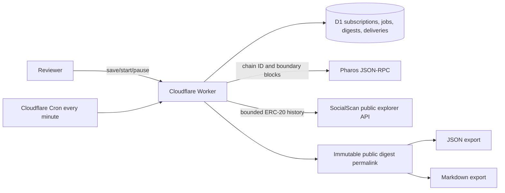

# Architecture

The scheduler persists the period job before execution. A unique idempotency key prevents duplicate period jobs, a conditional lease prevents concurrent execution, and expired/failed jobs are retried. Publication and delivery records are unique by job. Schedules advance independently because their persisted jobs remain recoverable.

The official Pharos Chain MCP was used for foundation capability and chain verification. Production uses explicitly named JSON-RPC and explorer transports because a Cloudflare Worker cannot assume an interactive MCP session.
